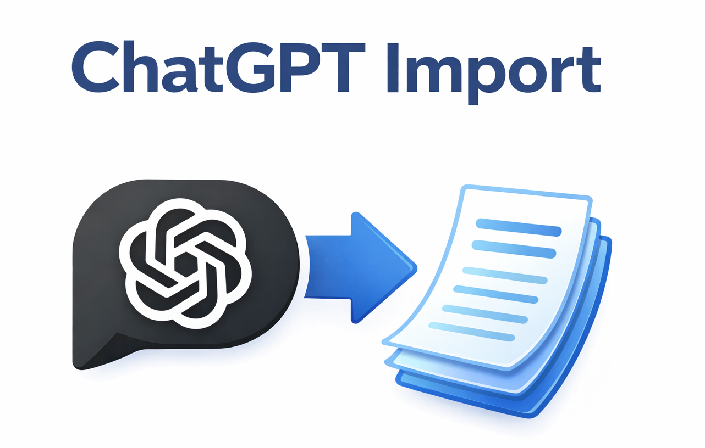

# AI Chat Import Plugin for Joplin



AI assistants such as ChatGPT and Claude are useful tools, but their privacy policies may raise concerns, and you may not like the idea of having all your conversations stored on remote servers. These servers can be hacked, or the data could potentially be accessed by governments or other authorities.

This plugin allows you to export your chat history from ChatGPT or Claude and import it into Joplin. Your conversations are then stored locally in your notes, either kept offline or securely synchronised using end-to-end encryption. Once your chats are safely archived in Joplin, you can delete them from the service with peace of mind.

Because these exports can be large, and you may prefer to synchronise them differently from your regular notes (or not synchronise them at all), you might want to [create a new profile](https://joplinapp.org/help/apps/profiles/) dedicated to this data.

## Supported services

| Service | What is imported |
|---------|------------------|
| ChatGPT | Conversations, with attached and generated images, audio and video as Joplin resources. Files from the ChatGPT library are attached to the conversation that created them, or collected in a "ChatGPT Library" note. |
| Claude | Conversations, pasted text, and the docs Claude created or edited. Claude exports do not contain uploaded files. |

## Features

- Both services produce notes in the same format
- Preserves conversation structure with user/assistant messages
- Preserves original conversation timestamps
- Configurable note titles with date/time formatting
- Tool calls (web searches, file reads, connectors...) can be shown in full, reduced to the call, or hidden
- Optional collapsible sections for tool outputs and thinking

## Usage

### ChatGPT

1. Export your data from ChatGPT:
   - Go to ChatGPT Settings > Data Controls > Export Data
   - Wait for the export email and download the ZIP file

2. Import into Joplin:
   - Go to **File > Import > ChatGPT Export (ZIP)**
   - Select your downloaded ZIP file
   - Wait for the import to complete

All conversations will be imported into a new "ChatGPT Import" notebook.

### Claude

1. Export your data from Claude:
   - Request a data export from Claude's settings
   - You will receive a manifest file (`manifest-....json`) listing several ZIP files, each with its own download link
   - Create an empty folder, and download every ZIP file listed in the manifest into it (`conversations-000.zip`, `projects-000.zip`, `frames-000.zip`...). Do not unzip them. The links expire after 24 hours and may only work once, so download each file completely.

2. Import into Joplin:
   - Go to **File > Import > Claude Export (folder)**
   - Select the folder containing the downloaded ZIP files
   - Wait for the import to complete

Conversations are imported into a new "Claude Import" notebook. Docs created or edited by Claude are included in the conversation where it worked on them, after its last change. Since the export only contains the final version of each doc, that is the version shown.

Note that Claude exports do not include uploaded images or documents, only their names, so these appear as a short notice in the note. Pasted text is included in full. Projects are not imported: the export does not record which project a conversation belongs to, so only their names and settings could be imported, unconnected to any conversation.

## Settings

Configure the plugin in **Tools > Options > AI Chat Import**:

| Setting | Description | Default |
|---------|-------------|---------|
| User name | Display name for user messages | `User` |
| ChatGPT assistant name | Display name for assistant messages in ChatGPT conversations | `ChatGPT` |
| Claude assistant name | Display name for assistant messages in Claude conversations | `Claude` |
| Note title format | Format string for note titles (see below) | `{date} {title}` |
| Show date in note body | Display conversation date below the title | `false` |
| Use collapsible sections | Wrap tool outputs in collapsible `<details>` tags | `true` |
| Tool calls | How tool calls (web searches, file reads, connectors...) are shown: `Full` (call and output), `Call only` (tool name and input), or `Hide`. Images generated by a tool are always kept. | `Hide` |
| Include thinking/reasoning | Include internal thinking messages from the assistant | `false` |
| Quote user messages | Display user messages in blockquotes | `true` |

### Title Format Placeholders

- `{title}` - The conversation title
- `{date}` - Date in YYYY-MM-DD format
- `{date:FORMAT}` - Date with custom format
- `{time}` - Time in HH:MM format

Custom date FORMAT can use: `YYYY`, `YY`, `MM`, `M`, `DD`, `D`

Examples:
- `{date} {title}` → "2024-01-15 My Conversation"
- `{title} ({date:MM/DD/YY})` → "My Conversation (01/15/24)"
- `{date} {time} - {title}` → "2024-01-15 14:30 - My Conversation"

## Building from Source

```bash
npm install
npm run dist
```

The built plugin will be in the `publish/` directory.

## Credits

- Code to do the Markdown conversion based on [ChatGPT Conversations To Markdown
](https://github.com/daugaard47/ChatGPT_Conversations_To_Markdown) by [daugaard47](https://github.com/daugaard47)

## License

MIT
